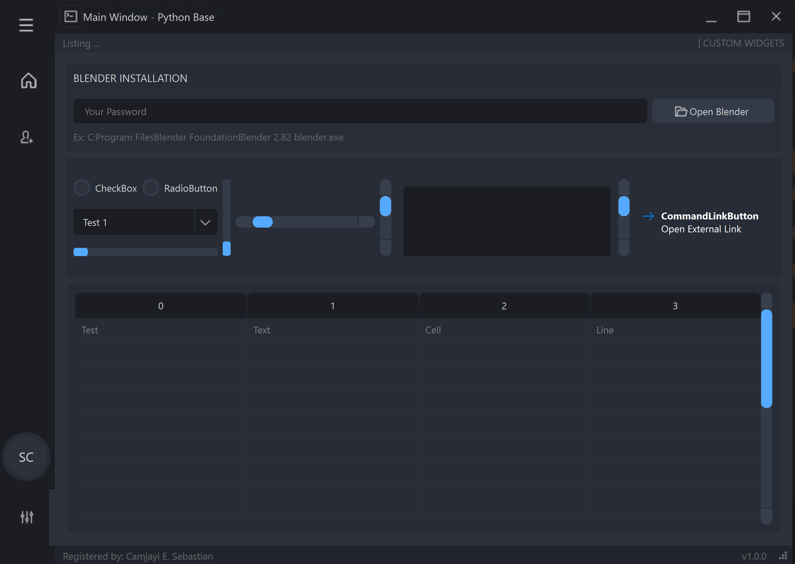
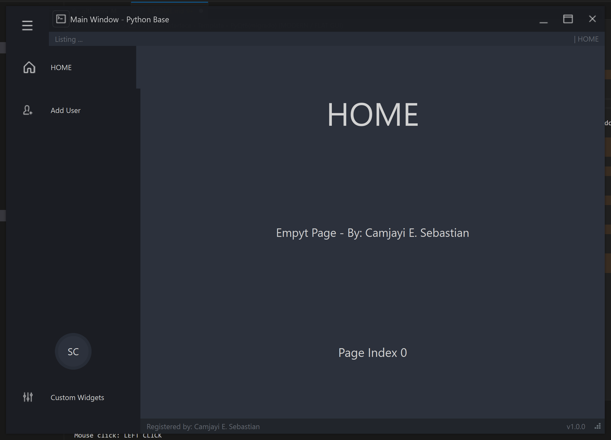
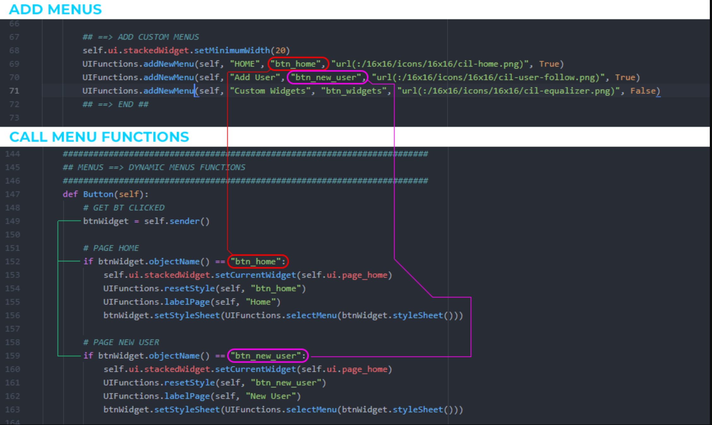

# NetfloxPyDesk (PyQt6)

> **Warning**: usar PyQt6 > PyQt6-6.8.1 PyQt6-Qt6-6.8.2 PyQt6-sip-13.10.0 (`pip install PyQt6`)





NetfloxPyDesk es una aplicación de escritorio hecha con Python, Qt Designer y PyQt6, construida sobre un template base UIXCore (dark/flat GUI para PyQt6).

Incluye navegación por menú dinámico con las secciones HOME, Add User, Custom Widgets y Movies.

Este proyecto funciona muy bien en Windows; en Linux y macOS hay problemas conocidos con el tamaño de las fuentes y la barra de título personalizada no funciona correctamente (heredado del template base).

## Requerimientos

```sh
python -m venv env
.\env\Scripts\Activate
pip install PyQt6
```

## Cómo correr

```sh
python main.py
```

## Menús



- **HOME** - página de inicio
- **Add User** - (en desarrollo)
- **Custom Widgets** - showcase de widgets del template
- **Movies** - sección nueva, actualmente vacía, preparada para futuras funcionalidades


## Créditos
Basado en el template UIXCore (PyQt6) - desk template dark/flat GUI.
